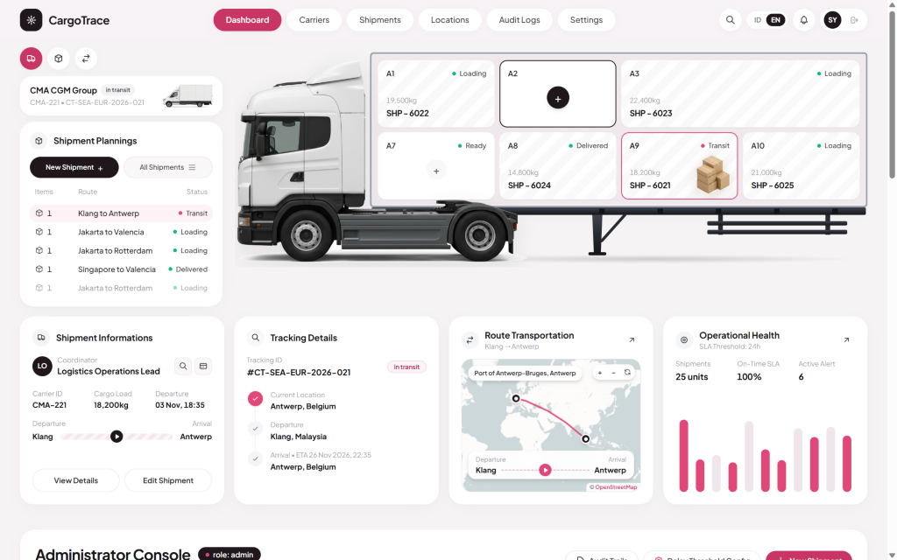
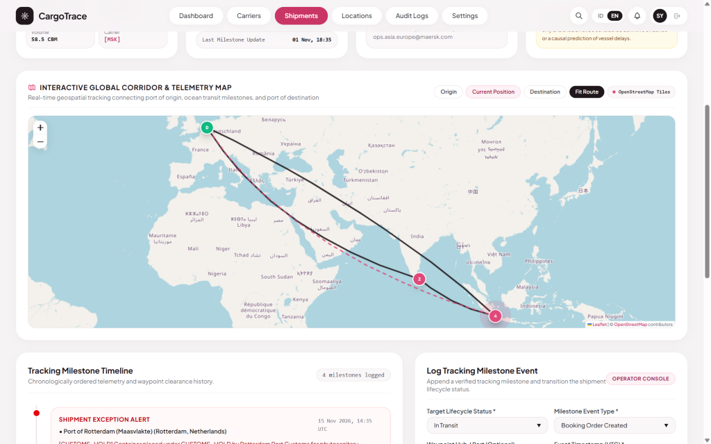
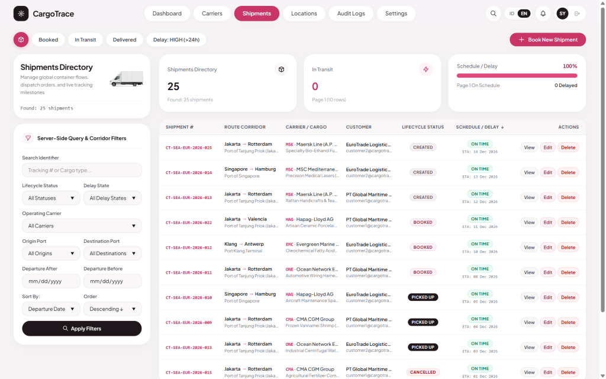
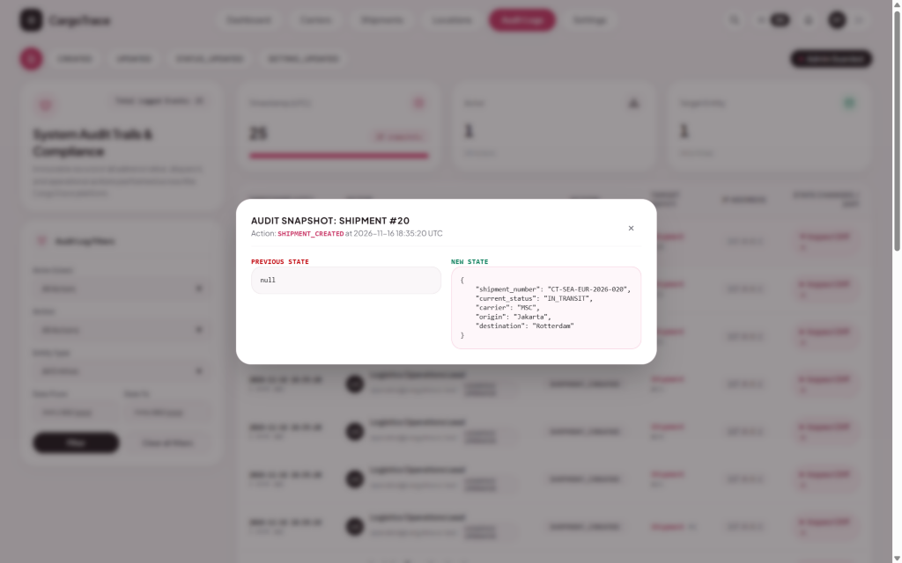

# CargoTrace &middot; Global Shipment Visibility & Tracking Platform

[](https://laravel.com)
[](https://php.net)
[](https://tailwindcss.com)
[](https://phpunit.de)
[](https://laravel.com/docs/sanctum)
[](https://leafletjs.com)
[](LICENSE)

> **UAS Web Programming 2 &middot; Final Portfolio Project**  
> An enterprise-grade, full-stack logistics visibility platform built with **PHP 8.3**, **Laravel 12**, **MySQL 8**, **Tailwind CSS v4**, **Vanilla JavaScript (Fetch API)**, **Leaflet.js**, and **Chart.js**.

---

## 1. Problem Statement & Solution

### The Logistics Visibility Problem
Global supply chains suffer from fragmented milestone updates, opaque delay classifications, and lack of real-time situational awareness. When maritime container ships transit complex intercontinental corridors (such as Southeast Asia to Northern Europe), consignees frequently experience unannounced port detentions, customs holds, and unpredictable arrival delays without actionable tracking data or meteorological context.

### The CargoTrace Solution
**CargoTrace** is a portfolio-grade container tracking and visibility platform engineered following modern clean architecture and service-layer separation. It delivers:
- **Strict Role-Based Multi-Tenancy**: Dedicated, role-enforced portals for Platform Administrators, Logistics Operators, and Consignee Customers.
- **Finite State Machine (FSM) Lifecycle**: Deterministic status transitions (`CREATED` &rarr; `BOOKED` &rarr; `PICKED_UP` &rarr; `IN_TRANSIT` &rarr; `DELIVERED`), strictly preventing illegal jumps and locking terminal states.
- **Configurable ETA & Delay Rules**: Automated detection and classification of delays (`LOW`, `MEDIUM`, `HIGH`) evaluated against a configurable threshold (default: 24 hours).
- **Interactive Maritime Telemetry**: Geospatial corridor visualization with Leaflet.js, OpenStreetMap tiles, chronological waypoint polylines, and real-time contextual weather telemetry via Open-Meteo.
- **Audit Trails & Security Compliance**: Immutable tracking of actor actions, IP addresses, and state changes with side-by-side JSON diffs.

---

## 2. Group Corridor & Academic Benchmark Parameters

- **Primary Route Corridor**: Southeast Asia &rarr; Europe (Port of Tanjung Priok / Singapore &rarr; Rotterdam / Hamburg / Antwerp).
- **Delay Threshold**: `24 hours` (Configurable at runtime by Administrator via UI or `config/cargotrace.php`).
- **Primary Operational Exception**: `CUSTOMS_HOLD` (Supported by `PORT_CONGESTION`, `WEATHER_DELAY`, `DAMAGED`, `DOCUMENTATION_ISSUE`).
- **Core KPIs Tracked**:
  1. **On-Time Delivery Rate (%)**: Percentage of fulfilled shipments delivered on or before expected ETA.
  2. **Average Delay Duration (Hours)**: Mean delay duration across active delayed shipments.
  3. **Exception Resolution Time (Hours)**: Mean time taken from incident logging (`OPEN`) to resolution (`RESOLVED`).

---

## 3. Technology Stack

- **Backend**: PHP 8.3+, Laravel 12 (Service Layer Architecture, Form Requests, Policies, Observers, API Resources).
- **Database**: MySQL 8.0 (InnoDB, foreign key constraints, JSON fields, indexed relations).
- **Frontend**: Blade Templating, Tailwind CSS v4, Vanilla JavaScript (Modern Fetch API, zero frontend bloat).
- **API & Authentication**: Laravel Sanctum (Stateful session authentication + Bearer Tokens with rate limiting).
- **Maps & Geodata**: Leaflet.js 1.9.4, OpenStreetMap Cartographic Tiles, OpenStreetMap Nominatim Geocoding API.
- **Meteorological Telemetry**: Open-Meteo API (WMO Code mapping, ambient conditions).
- **Data Visualizations**: Chart.js 4.6.x (Doughnut & Bar charts with Camellia Pink & Obsidian palette).
- **Testing**: PHPUnit 12 with SQLite in-memory testing configuration (`136 tests, 617 assertions`).
- **Code Quality**: Laravel Pint (PSR-12 / Laravel opinionated formatting).

---

## 4. Key Feature Matrix

| Feature Module | Description | Authorized Roles |
|---|---|---|
| **Role-Specific Dashboards** | Real-time aggregate metric cards, Chart.js graphs, strategic corridor KPIs, and work queues. Avoids N+1 queries. | Admin, Operator, Customer (scoped) |
| **Shipments Directory** | Server-side search (number/cargo), multi-parameter filtering (status, delay, carrier, origin, destination, date range), and sorting with query string preservation. | All (Customer scoped) |
| **Status FSM Lifecycle** | Append-only event history, chronological timestamps, immutable `DELIVERED` terminal state. | Admin, Operator (Manage), All (View) |
| **Corridor Map & Live Weather** | Interactive Leaflet map with origin/destination pins, numbered waypoint markers, route polylines, and non-causal weather telemetry card. | All Roles |
| **Exception Management** | Flag operational exceptions, transition status (`OPEN` &rarr; `INVESTIGATING` &rarr; `RESOLVED`), and broadcast notifications. | Admin, Operator |
| **In-App Notification Center** | Bell icon with unread counter badge, notification index, mark individual read, and mark all as read. | All Roles (Strictly isolated) |
| **System Audit Trails** | Filterable compliance log recording actors, actions, target entities, IP addresses, and interactive visual JSON diffs. | Admin Only |
| **Master Data CRUD** | Manage Carriers (with unique codes) and Locations (with interactive auto-geocoding GPS button). | Admin (Write), Operator (Read) |
| **Sanctum REST API** | 18 full-featured REST API endpoints with Form Requests, API Resources, and RFC-compliant error responses. | Authenticated via Sanctum Bearer Token |

---

## 5. UI Screenshots & Visual Walkthrough

> *Screenshots captured from active development server (`http://localhost:8000`)*

### 1. Administrator Intelligence Console

*Real-time platform metrics, 4 Chart.js analytics graphs, strategic corridor KPIs, active exception queue, and recent shipments feed.*

### 2. Interactive Global Corridor Map & Weather Telemetry

*Leaflet.js route corridor map connecting Southeast Asia to Europe with chronological waypoints, popup details, and ambient meteorological telemetry.*

### 3. Server-Side Shipments Directory & Multi-Parameter Filter

*Multi-parameter filter bar (Search, Status, Delay, Carrier, Origin, Destination, Dates), sorting controls, active filter pills, and preserved paginator.*

### 4. System Audit Compliance & State Changes Diff Inspector

*Admin-only audit trail with filter criteria and expandable JSON state change diffs comparing previous and new attributes.*

---

## 6. Demo Accounts & Documented Credentials

All accounts are pre-seeded with password **`Password123!`**:

| Role | Email | Password | Primary Responsibility |
|---|---|---|---|
| **Administrator** | `admin@cargotrace.test` | `Password123!` | Full platform administration, threshold settings, carrier/location management, audit compliance. |
| **Logistics Operator** | `operator@cargotrace.test` | `Password123!` | Create/update shipments, log tracking milestones, investigate and resolve exceptions. |
| **Customer 1** | `customer1@cargotrace.test` | `Password123!` | Consignee visibility: private cargo bookings, interactive map, in-app notifications. |
| **Customer 2** | `customer2@cargotrace.test` | `Password123!` | Corporate enterprise client with distinct assigned shipments. |

---

## 7. Local Installation & Setup Guide

### Prerequisites
- PHP &ge; 8.3
- Composer &ge; 2.6
- Node.js &ge; 20.x & npm
- MySQL Server &ge; 8.0

### Step-by-Step Installation
1. **Clone the repository**:
   ```bash
   git clone https://github.com/Nailasafarina/CargoTrace.git
   cd cargotrace
   ```

2. **Install PHP and Node dependencies**:
   ```bash
   composer install
   npm install
   ```

3. **Configure Environment File**:
   ```bash
   cp .env.example .env
   php artisan key:generate
   ```

4. **Set Database Credentials in `.env`**:
   ```ini
   DB_CONNECTION=mysql
   DB_HOST=127.0.0.1
   DB_PORT=3306
   DB_DATABASE=cargotrace
   DB_USERNAME=root
   DB_PASSWORD=
   ```

5. **Execute Migrations & Seed Demo Fleet**:
   ```bash
   php artisan migrate:fresh --seed
   ```

6. **Compile Frontend Assets**:
   ```bash
   npm run build
   # Or run Vite development watcher:
   # npm run dev
   ```

7. **Launch the Local Development Server**:
   ```bash
   php artisan serve
   ```
   Open `http://localhost:8000` in your browser.

---

## 8. Running Automated Tests

CargoTrace features a comprehensive suite of **136 automated unit and feature tests**:

```bash
# Execute entire test suite (using in-memory SQLite database)
php artisan test

# Run specific domain test suites
php artisan test tests/Feature/DashboardTest.php
php artisan test tests/Feature/ShipmentFilterTest.php
php artisan test tests/Feature/SecurityAuditTest.php
php artisan test tests/Feature/ExternalServicesTest.php
php artisan test tests/Feature/ApiTest.php
```

All tests execute in-memory with zero side-effects to your local MySQL database.

---

## 9. REST API & Postman Collection

The application exposes 18 Sanctum-authenticated JSON API endpoints.

- **Postman Collection File**: [`docs/postman/CargoTrace.postman_collection.json`](docs/postman/CargoTrace.postman_collection.json)
- **API Documentation**: Detailed request schemas and error specifications are documented in [`docs/api.md`](docs/api.md).

### Quick Example: Authenticate and Fetch Shipments
```bash
# 1. Login and obtain Sanctum Bearer Token
curl -X POST http://localhost:8000/api/login \
  -H "Content-Type: application/json" \
  -H "Accept: application/json" \
  -d '{"email":"operator@cargotrace.test","password":"Password123!"}'

# 2. Query shipments using token
curl -X GET "http://localhost:8000/api/shipments?status=IN_TRANSIT" \
  -H "Accept: application/json" \
  -H "Authorization: Bearer <YOUR_TOKEN>"
```

---

## 10. Production Deployment

Detailed deployment guides for **Docker Compose** and **Ubuntu VPS (Nginx + PHP 8.3-FPM)** are available in [`docs/deployment.md`](docs/deployment.md).

### Quick Production Deployment via Docker
```bash
# 1. Launch containers in background
docker compose up -d --build

# 2. Run migrations and seed data
docker compose exec app php artisan migrate --force --seed

# 3. Cache application configurations
docker compose exec app php artisan config:cache
docker compose exec app php artisan route:cache
docker compose exec app php artisan view:cache
```

---

## 11. Known Limitations

1. **Third-Party Rate Limits**: Forward geocoding through OpenStreetMap Nominatim relies on public servers subject to a 1 request/second usage policy. In high-volume production, a self-hosted Nominatim instance or commercial provider (Mapbox / Google Geocoding) is recommended.
2. **Offline Marine Gaps**: Real maritime AIS transponders occasionally lose satellite connectivity in remote open oceans (e.g. middle of the Indian Ocean). Milestone telemetry represents port checks and reported coordinates.
3. **Single Currency / Imperial Units**: Cargo measurements currently standardize on Metric units (Kilograms, Cubic Meters) and WGS84 decimal coordinates.

---

## 12. Future Roadmap

- [ ] **AIS Satellite Live Tracking**: Direct webhook ingestion from Spire Maritime or VesselFinder AIS APIs.
- [ ] **Automated IoT Sensor Telemetry**: Ingestion of container reefer temperatures, humidity, and shock sensor events.
- [ ] **Multi-Leg Multimodal Tracking**: Explicit support for intermodal transfers (Ocean Vessel &rarr; Freight Train &rarr; Inland Trucking).
- [ ] **PDF Bill of Lading (BOL) Export**: Dynamic generation of international maritime consignment documentation.
- [ ] **Webhook Subscriptions**: Customer-configurable HTTP webhooks for automated ERP / TMS integration.

---

## 13. Project Documentation Links

- [System Architecture & Data Flow](docs/architecture.md)
- [Entity Relationship Diagram (ERD)](docs/erd.md)
- [Database Data Dictionary](docs/data-dictionary.md)
- [REST API Specifications](docs/api.md)
- [Security Checklist & Vulnerability Audit](docs/security-checklist.md)
- [Production Deployment Guide](docs/deployment.md)
- [Third-Party & Open Source Attributions](ATTRIBUTION.md)

---

## 14. License

This project is open-sourced software licensed under the [MIT License](LICENSE).
