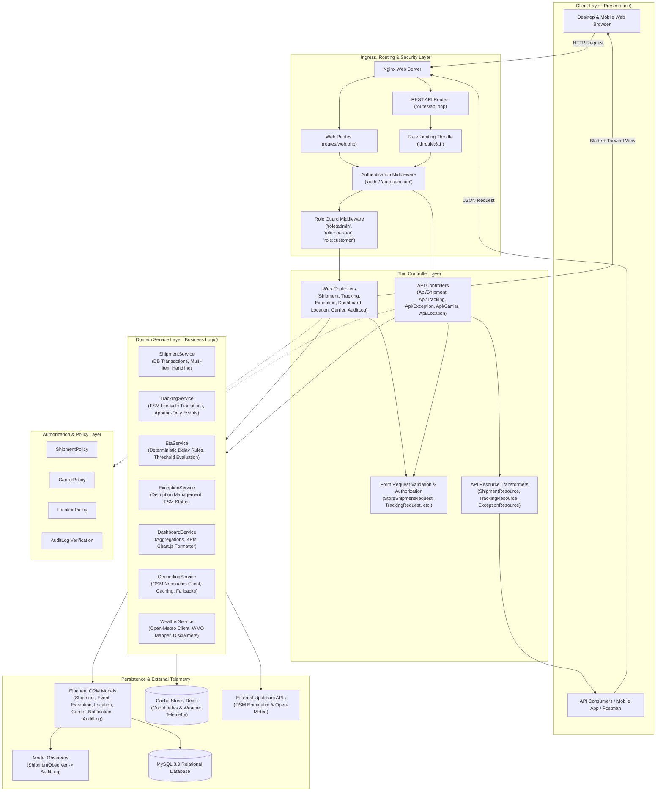

# CargoTrace System Architecture Documentation

This document describes the software architecture, architectural layers, request lifecycle, and data flow of **CargoTrace: Global Shipment Visibility & Tracking Platform**.

---

## 1. High-Level Architectural Diagram

---

## 2. Layer Responsibilities & Architectural Patterns

### A. Presentation Layer (Blade + Tailwind CSS v4 + Vanilla JS)
- **Zero Heavy Frontend Frameworks**: Implemented using clean server-rendered Blade templates, Tailwind CSS v4 utility classes, and Vanilla JavaScript (Fetch API).
- **Interactive UI Components**:
  - **Leaflet.js & OpenStreetMap**: Interactive route corridor maps with colored pins, popup telemetry, polyline milestones, and WGS84 coordinates.
  - **Chart.js**: Dark-mode operational analytics (status doughnut, carrier allocation bar, delay severity, and exception type charts).
  - **Vanilla Fetch API**: Asynchronous auto-geocoding in Location forms without page reloads.

### B. Controller Layer (Thin Controllers)
- Controllers are strictly responsible for:
  1. Authorizing incoming actions via Policies or Gates.
  2. Receiving validated inputs via Form Request classes.
  3. Delegating domain business logic to Domain Services.
  4. Returning HTTP responses (Views or JSON Resources).
- Controllers **never** execute raw database queries, multivariable calculations, or complex state transitions directly.

### C. Domain Service Layer
- **ShipmentService**: Orchestrates shipment creation, atomic database transactions for shipment + items, and auditing.
- **TrackingService**: Enforces the Finite State Machine (FSM) rules for status transitions (`CREATED` &rarr; `BOOKED` &rarr; `PICKED_UP` &rarr; `IN_TRANSIT` &rarr; `DELIVERED`). `DELIVERED` is strictly terminal. Appends tracking history without modifying past records.
- **EtaService**: Evaluates deterministic delay rules (`estimated_arrival_at > expected_arrival_at`). Classifies severity into `LOW` (&le;6h), `MEDIUM` (6–24h), and `HIGH` (&gt;24h) based on configurable thresholds.
- **ExceptionService**: Handles disruption logging (`CUSTOMS_HOLD`, `WEATHER_DELAY`, `PORT_CONGESTION`) and FSM status updates (`OPEN` &rarr; `INVESTIGATING` &rarr; `RESOLVED`).
- **DashboardService**: Optimizes aggregate database queries (`count`, `group by`, `avg`) to avoid N+1 queries and formats metric payloads for Chart.js.
- **GeocodingService & WeatherService**: Resilient HTTP Client integrations with timeouts, retries, caching, and fallback handling.

### D. Security & Data Integrity Layer
- **Multi-Tenant / Role Isolation**: Customer users are strictly isolated to their own shipments and notifications at both Controller and Policy levels.
- **Audit Trails**: [AuditLog.php](file:///E:/coding/UAS%20pemograman%20web/app/Models/AuditLog.php) records actor, action, timestamp, IP address, and JSON diffs of state changes across administrative and operational events.
