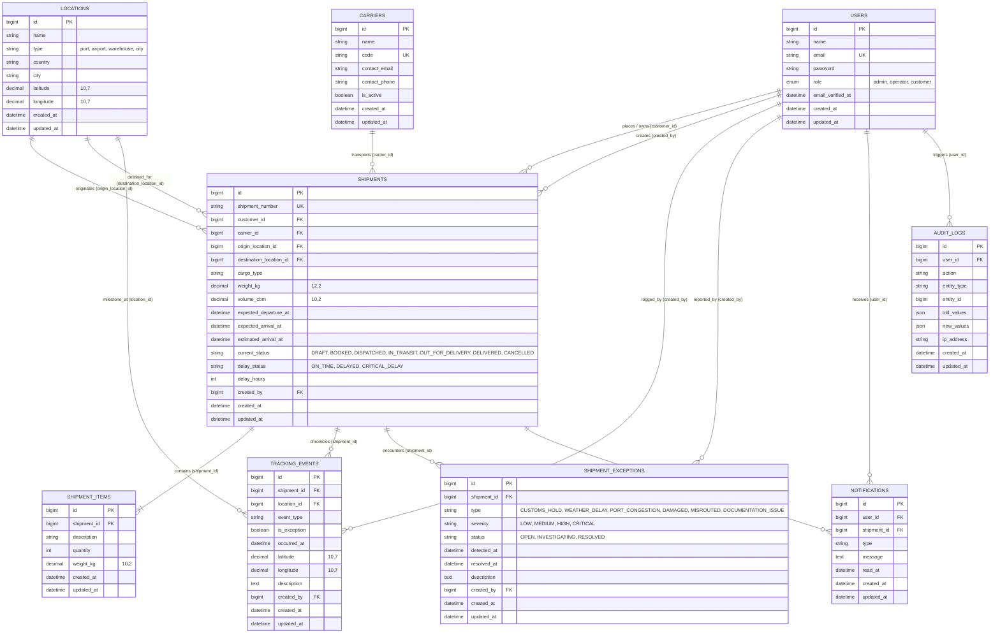

# Entity-Relationship Diagram (ERD) - CargoTrace Platform

This document describes the relational database architecture for **CargoTrace: Global Shipment Visibility & Tracking Platform**.

---

## Mermaid ER Diagram

---

## Cardinality & Relationship Breakdown

1. **Users &rarr; Shipments (Customer)**: `1 : N` (One Customer owns Zero or Many Shipments). Enforces customer data isolation.
2. **Users &rarr; Shipments (Creator)**: `1 : N` (One Operator/Admin user creates Zero or Many Shipments).
3. **Carriers &rarr; Shipments**: `1 : N` (One Freight Carrier transports Zero or Many Shipments).
4. **Locations &rarr; Shipments (Origin & Destination)**: `1 : N` (One Port/Hub serves as the departure/arrival terminal for Many Shipments).
5. **Shipments &rarr; Shipment Items**: `1 : N` (One Shipment contains One or Many individual packaged cargo items/manifest lines).
6. **Shipments &rarr; Tracking Events**: `1 : N` (One Shipment has Zero or Many chronological tracking milestones).
7. **Shipments &rarr; Shipment Exceptions**: `1 : N` (One Shipment can experience Zero or Many operational issues, e.g., `CUSTOMS_HOLD`).
8. **Users &rarr; Notifications**: `1 : N` (One User receives Zero or Many alerts).
9. **Users &rarr; Audit Logs**: `1 : N` (One User generates Zero or Many immutable audit records).
